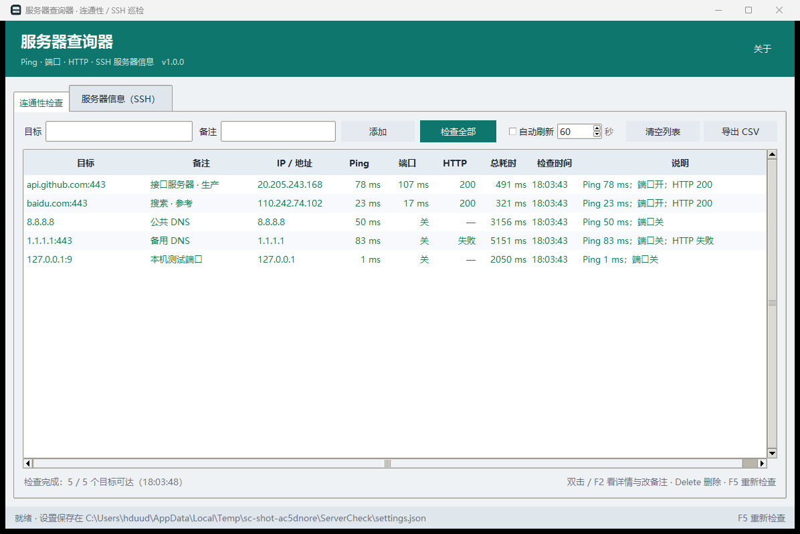

# 服务器查询器（ServerCheck）

[](https://github.com/112-a-eng/112-servercheck/releases/latest)
[](LICENSE)

Windows 桌面服务器巡检小工具：**连通性检查**（Ping / TCP 端口 / HTTP 状态）+ **SSH 服务器信息**（系统、CPU、内存、磁盘、负载）。
Python + tkinter 写的，能打包成单文件 exe，双击即用。

**免安装**：从 [Releases](https://github.com/112-a-eng/112-servercheck/releases/latest) 下载
`ServerCheck-v1.0.0.exe`（单文件，Windows 10/11 x64），双击即可使用。



## 功能

**连通性检查**

- 目标支持四种写法：`8.8.8.8`、`example.com:22`、`https://example.com/path`、`[::1]:443`
- 一次添加多个（逗号 / 空格分隔），表格里显示：解析到的 IP、Ping 延迟、端口状态、HTTP 状态码、总耗时、说明
- **备注**：每个目标可以写一句备注（生产环境 / 负责人 / 用途），添加时直接填；之后**双击该行或按 F2** 修改，
  右键菜单还能「复制目标 / 删除这一行」，备注跟着目标一起保存
- 并发检查（最多 8 个线程），**自动刷新**可设间隔（5 秒 ~ 1 小时），结果带颜色（通=绿、不通=红）
- 结果可导出 CSV（含备注列）；目标列表自动保存，下次打开还在

**服务器信息（SSH）**

- 支持**密码**和**私钥文件**两种认证，端口可改
- 一键采集并排版：系统版本、运行时长与负载、CPU（核数 / 型号 / 占用 Top5）、内存、磁盘、网卡地址、登录用户
- 自动识别 Linux / Windows 服务器（Windows 走 PowerShell / CIM 采集）
- 顶部给出摘要（内存使用率、负载、根分区使用率）；报告可复制或存成 TXT
- SSH 主机也能填**备注**，会写进巡检报告抬头（`备注：生产 Web`）
- 密码只放在内存里，**不会写入磁盘**

## 运行

需要 Python 3.11+ 和 `paramiko`：

```powershell
py -m pip install paramiko
py servercheck_gui.py            # 打开界面
py -m servercheck --self-test    # 无界面自测（8 项，不开窗口、不联网）
```

## 打包成 exe

```powershell
py -m pip install pyinstaller
powershell -ExecutionPolicy Bypass -File .\build_exe.ps1                 # onedir → dist\服务器查询器\
powershell -ExecutionPolicy Bypass -File .\build_exe.ps1 -Mode onefile   # 单文件 → dist\服务器查询器.exe
```

图标由 `tools\make_icon.py` 现场生成（纯标准库画的机架 + 绿色状态灯）。
打包前会先跑一遍自测，不通过就中止。

## 文件位置

- 目标列表（含备注）/ SSH 主机信息（含备注）：`%APPDATA%\ServerCheck\settings.json`（不含密码）
- 启动异常日志：`%TEMP%\servercheck-crash.txt`

## 自测覆盖（8 项，全离线）

目标解析（IPv4 / IPv6 / 端口 / 网址 / 错误写法）、ping 输出解析（中英文、`<1ms`）、
**目标备注规范化**（旧版纯字符串设置自动升级、去重、空值丢弃）、
**设置读写**（目标备注与 SSH 备注能存回，密码不落盘）、巡检报告抬头（有备注才输出备注行）、
本机不可用端口与 HTTP 失败路径、paramiko 在位与失败提示。

## 结构

```
servercheck/          程序包
  config.py             常量、设置读写（%APPDATA%）
  netcheck.py           目标解析、Ping、TCP、HTTP 检查
  sshdash.py            SSH 登录与信息采集（paramiko）
  ui.py                 tkinter 界面（两个标签页）
  selftest.py           无界面自测
  __main__.py           入口（--self-test / --log）
servercheck_gui.py      启动器 / 打包入口
build_exe.ps1           打包脚本（onedir / onefile）
tools/make_icon.py      图标生成
docs/                   截图
```

## 已知限制

- Ping 调用系统 `ping` 命令（Windows 上 ICMP 需要权限，普通用户可发回显请求，没问题）
- SSH 只做信息采集，不提供命令行终端；主机指纹用 `AutoAddPolicy`（信任首次连接的主机）
- Windows 服务器的采集依赖远程 PowerShell 可用（OpenSSH Server + PowerShell）
- 单文件 exe 每次启动要自解压，约 3~5 秒；想快就用 onedir 模式

## License

MIT
